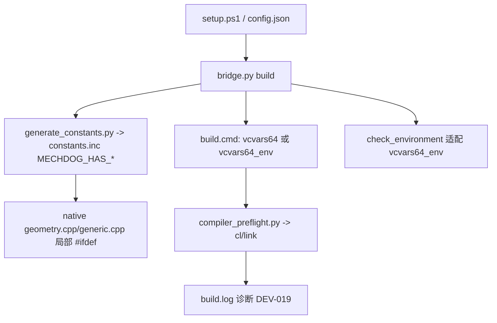

## 用户需求

把 **BUG-033 + DEV-019/020/021/022** 打成一批「Creo 9 编译与安装闭环」，一次收口，体积小、可回滚。

## 批次目标
让源码在旧版（Creo 9 / Toolkit 9）SDK 上可编译，同时补齐这轮 0.3.2 反馈暴露的安装链诊断能力，使上一轮文档已声明的「Creo 9 仅编译可用」与实现一致。

## 包含条目
- **BUG-033**：`generate_constants.py` 输出 `MECHDOG_HAS_*` 探测宏，对 `PRO_E_HLE_ADD_PARAMETERS` / `PRO_HOLE_NO_PARAMETERS_FLAG` 做 `#ifdef` 包裹，使旧 SDK 缺常量时不再编译失败。
- **DEV-019**：构建失败诊断，解析 `build/build.log`，命中 `error C2065` 且标识符以 `PRO_` 开头时给出 SDK 版本方向提示，并无条件附 error 行摘要（≤15 行）。
- **DEV-020**：`INSTALL.md` 补充 VS Build Tools `--includeRecommended` 官方命令与「静默假成功、无编译器」症状说明。
- **DEV-021**：`config.json` 支持显式 `vcvars64_env`（INCLUDE/LIB/PATH），`build.cmd` 直接 set 后编译，绕开 vcvars64.bat 的注册表探测；`setup.ps1` 增加显式参数。
- **DEV-022**：`setup.ps1` 命中 WindowsApps 商店占位 `python.exe` 时，报错提示其为占位程序并指引用 `-Python`。

## 已确认口径（硬约束）
- q-0：新开 **DEV-028** 作为批次条目，记录目标、5 个条目与统一验收，BACKLOG 当前进展引用它。
- q-1：**合并为 1 个提交**，标题列出批次与全部条目 ID。
- q-2：**本轮执行实机回归**，用已在运行的 Creo 12.4 编译并跑孔特征原生回归，记录 `saved_file_reloaded_and_verified`。
- q-3：DEV-021 入口做到 **config.json + setup.ps1 参数** 两层。
- 沿用前轮：不推送、不打标签、不发布；不改 `version.py`；不动 `.codebuddy/`、`.workbuddy/`、`build/`、`.venv/`。
- 未验证项如实标注：本机无 Creo 9 SDK，Creo 9 实机编译与运行时建模不设独立验收门槛、不外推为已通过。

## 视觉/交付效果
交付为可编译的原生扩展 + 更清晰的安装失败提示 + 同步后的台账与工作卡；无 UI 变更。


## 技术栈
沿用项目现有栈，不引入新依赖：
- 原生扩展：C++ + PTC Creo Toolkit SDK（`native/geometry.cpp`、`native/generic.cpp`）
- 常量生成：Python 3.12（`tools/generate_constants.py`）
- 服务/构建编排：Python（`bridge.py`）、PowerShell（`setup.ps1`）
- 测试：Python 单元测试（`tests/unit/test_*.py`）、`tools/dev_check.py`

## 实现方案

### 1. BUG-033 探测宏（核心）
在 `tools/generate_constants.py` 引入 `PROBES = ('PRO_E_HLE_ADD_PARAMETERS', 'PRO_HOLE_NO_PARAMETERS_FLAG')`，在生成 `native/constants.inc` 时对 `names & set(PROBES)` 追加 `#define MECHDOG_HAS_<NAME> 1`；把 `native/geometry.cpp:433` 与 `native/generic.cpp:1108` 两行用 `#ifdef MECHDOG_HAS_PRO_E_HLE_ADD_PARAMETERS ... #endif` 包裹（`PRO_E_HLE_ADD_NOTE` 在 Creo 9 存在，保留不动）。
- **关键点**：当前 `generate(root)` 直接读 `root/config.json` 的 `creo_root`，无注入点，无法用夹具驱动单测。方案：为 `generate()` 增加可选注入参数（如 `inc_dir`/`config_path`），保持现有调用签名向后兼容（默认行为不变），单测通过构造临时 root + 伪 `config.json` + 伪 includes 目录驱动。
- 同步第 24 行硬编码注释「Creo 10 SDK」，避免误导。
- 多个探针按 `sorted()` 稳定输出，保证 `constants.inc` 字节稳定、避免无谓重写。

### 2. DEV-019 构建失败诊断
抽出可被单测驱动的纯函数（如 `diagnose_build_failure(returncode, log_text) -> str`），在 `bridge.py` 构建失败路径读取 `build/build.log`：
- 命中 `error C2065` 且标识符以 `PRO_` 开头 → 追加方向性提示（常量来自较新 SDK，本机 SDK 版本可能偏低）；
- 无条件附 error 行摘要（≤15 行，仅 error 级别）。
仅改 setup/bridge 阶段异常消息/stderr，不动 `server.py`（MCP stdout）。

### 3. DEV-021 显式编译环境（config.json + setup.ps1）
- `bridge.py config()`：新增 `vcvars64_env`（缺省 `null`），做与 `creo_root`/`vcvars64` 同类非法字符校验（`\r\n"%`），防止注入。
- `bridge.py check_environment()`：当配置了 `vcvars64_env` 时，`compiler_setup` 的文件存在性检查与 `compiler_environment` 描述走 env 分支，避免因 `vcvars64.bat` 不存在被判 `ready_to_build=false`。
- `bridge.py` 生成 `build/build.cmd`：配置了 `vcvars64_env` 时改为 `set INCLUDE=`/`set LIB=`/`set PATH=` 后直接编译，保留 `tools/compiler_preflight.py` 前置自检。
- `config.example.json`：加 `vcvars64_env: null` 示例。
- `setup.ps1`：新增显式参数，路径合法性校验一致；配置了 env 时可跳过「无 vcvars64 即 throw」；并回写本机 `config.json`（保留已有属性）。

### 4. DEV-022 占位 Python 提示
`setup.ps1` Python 探测命中 WindowsApps 路径（含 `WindowsApps` 片段）时，错误信息提示其为商店占位程序并指引 `-Python` 指定真实路径。

### 5. DEV-020 文档
`docs/INSTALL.md` 补充 `--includeRecommended` 命令与「退出码 0 但未装编译器/SDK」症状，并在故障排查表补齐与 DEV-021（`vcvars64_env`）、DEV-022（占位 Python）一致的指引。

## 性能与可靠性
- 常量生成保持 O(头文件行数)，探针集合固定小，开销可忽略；`constants.inc` 仅在内容变化时写盘，避免触发全量重编。
- 构建失败诊断只读 `build.log` 尾部，限定行数，避免大日志读入内存。
- `vcvars64_env` 直接注入构建环境，省去 `vcvars64.bat` 的 reg.exe 探测，规避受限环境失败。

## 架构设计
复用现有分层：生成器（`tools/generate_constants.py`）→ 原生扩展（`native/*.cpp`）→ 构建编排（`bridge.py`/`setup.ps1`）→ 文档/台账（`docs/*`）。本批只在既有模块内扩展，不新增架构模式。



## 目录结构（仅列新增/修改/受影响）

```
MCP_CREO_MechDog/
├── tools/
│   └── generate_constants.py        # [MODIFY] 加 PROBES + MECHDOG_HAS_* 输出；为 generate() 增加可注入参数（向后兼容）以支持夹具单测；同步注释
├── native/
│   ├── geometry.cpp                 # [MODIFY] PRO_E_HLE_ADD_PARAMETERS 行用 #ifdef MECHDOG_HAS_* 包裹
│   └── generic.cpp                  # [MODIFY] 同上
├── bridge.py                        # [MODIFY] config() 校验 vcvars64_env；check_environment() 适配；build.cmd 生成 env 分支；构建失败诊断（抽纯函数）
├── setup.ps1                        # [MODIFY] 新增 vcvars64_env 显式参数与回写；WindowsApps 占位 Python 提示；env 路径跳过 vcvars64 必需校验
├── config.example.json              # [MODIFY] 新增 vcvars64_env 示例（缺省 null）
├── tests/unit/
│   ├── test_generate_constants.py   # [NEW] 夹具常量集合：含/不含 PRO_E_HLE_ADD_PARAMETERS 时宏输出断言；constants.inc 稳定写入
│   ├── test_build_diagnostics.py    # [NEW] 伪 build.log：C2065+PRO_ 得提示+摘要；普通链接错误仅摘要
│   └── test_install_config.py       # [NEW] vcvars64_env 校验、check_environment 适配、build.cmd 生成分支
├── docs/INSTALL.md                  # [MODIFY] --includeRecommended、症状说明、vcvars64_env 与占位 Python 指引；修复后同步 BUG-033 表述
├── docs/COMPATIBILITY.md            # [MODIFY] 如实现落地则同步 Creo 9 行"编译已支持、运行时未验收"，保留未验证项
├── docs/BACKLOG.md                  # [MODIFY] DEV-019/020/021/022 补卡链+改状态；新增 DEV-028 行；当前进展引用 DEV-028
├── docs/BACKLOG_COMPLETED.md        # [MODIFY] 视完成情况登记（本批如整体完成则记录）
├── docs/work-items/DEV-028.md       # [NEW] 批次条目：目标、5 条目、统一验收、依赖顺序
├── docs/work-items/DEV-020.md       # [NEW] 按现有工作卡格式补全
├── docs/work-items/DEV-021.md       # [NEW] 同上
├── docs/work-items/DEV-022.md       # [NEW] 同上
├── docs/work-items/DEV-019.md       # [MODIFY] 状态与「实现与证据」
└── docs/work-items/BUG-033.md       # [MODIFY] 状态与「实现与证据」，标注 Creo 9 实机未验收
```

## 执行说明
- 先建分支 `codex/dev-028-creo9-compile-install`（当前 HEAD `b6c7daf`，工作树干净）。
- 单测放 `tests/unit/`，运行 `python tools/dev_check.py` 全过并记录。
- 实机回归：`python bridge.py build`（会重编 `build/creo_worker.exe`、`creo_blend_sync.dll`）+ `python tools/test_general.py` 孔特征项，记录 `saved_file_reloaded_and_verified=true`。
- 每张工作卡填「实现与证据」（变更文件、提交号、dirty、源码指纹、命令、环境、结果）。
- 最后**合并为 1 个提交**（标题含批次与全部条目 ID）；不推送、不打标签、不发布。
- 如实保留未验证项：本机无 Creo 9 SDK，Creo 9 实机编译与运行时建模未验收。


## Agent Extensions

### SubAgent
- **code-explorer**
  - Purpose: 在实现与收口阶段做只读核查，独立复核 `generate_constants.py` 探针注入点与 `constants.inc` 输出一致性、`bridge.py` 失败路径诊断函数与 `vcvars64_env` 分支的实际落点、`setup.ps1` 占位 Python / env 分支的准确行号，以及台账 ID 唯一性、相对链接与锚点、表格列数是否一致。
  - Expected outcome: 产出带路径与行号的核查结论，确认代码改动与文档/台账同步无遗漏、无失效链接，为合并提交前的最终验收提供独立证据。
